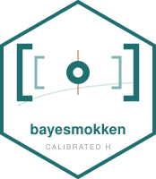
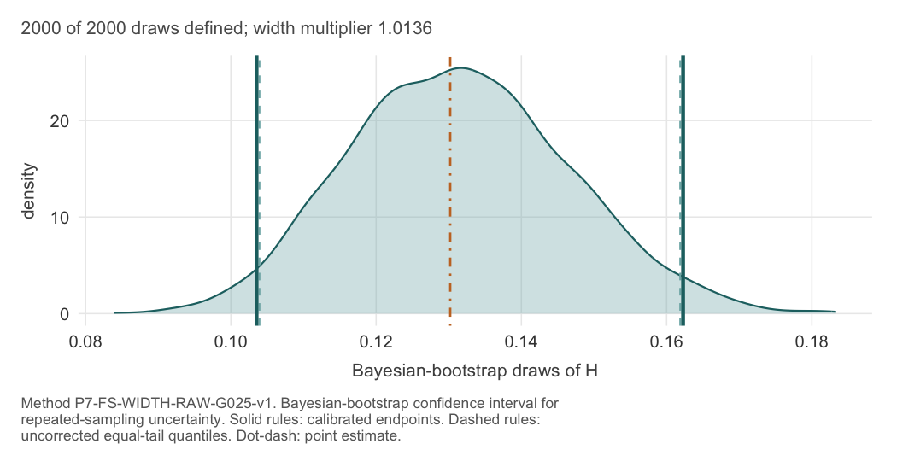

<!-- README.md is generated from README.Rmd. Edit the .Rmd and re-knit. -->

# bayesmokken 

<!-- badges: start -->

[](https://github.com/joonho112/bayesmokken/actions/workflows/R-CMD-check.yaml)
[](https://lifecycle.r-lib.org/articles/stages.html#experimental)
[](https://opensource.org/licenses/MIT)
<!-- badges: end -->

**Confidence intervals for the Mokken scalability coefficient $H$ whose
coverage was checked in large prespecified simulations rather than
assumed.**

Mokken scale analysis asks whether a fixed set of items behaves as a
scale and answers with a coefficient $H$. That coefficient is almost
always reported as a bare number: a paper says $H = 0.42$ and moves on,
and the reader cannot tell whether a second sample would have given
$0.41$ or $0.33$. Existing interval methods do exist, but the standard
Wald-type construction undercovers noticeably at realistic sample sizes,
and when respondents are nested in classrooms or clinics an interval
built on independence is too narrow for a more basic reason.

This package supplies intervals for both situations, and reports what
they cover.

## Installation

``` r
# install.packages("remotes")
remotes::install_github("joonho112/bayesmokken")
```

## Five minutes

``` r
library(bayesmokken)

data(srs)                                    # 11 binary items, 337 respondents
fit <- bb_mokken_h(srs, draws = 2000, seed = 1)
fit
#> ── Mokken scalability H · Bayesian-bootstrap interval ──────────────────────────────
#>   estimand     fixed 11-item binary scale, complete-scale respondents
#>   method       P7-FS-WIDTH-RAW-G025-v1  (raw base: CMP-RAW-BB-EQUAL-TAIL-v1)
#>   sample       n = 337 complete · patterns = 245 · draws = 2000
#> 
#>   scale H      0.130   95% CI [0.104, 0.162]      status: OK
#>                raw     [0.104, 0.162]  ->  width x 1.0136
#>                (the correction changes the length by 0.00079, below 3-digit display)
#> 
#>   Interpretation: Bayesian-bootstrap-based confidence interval for
#>   repeated-sampling uncertainty; not a posterior credible interval or posterior
#>   probability.
#> 
#>   See: summary() · bm_item_h() · bm_plot_draws() · bm_diagnostics()
```

Both intervals are always shown — the uncorrected one and the corrected
one, with the factor between them — so the correction is never
invisible.

``` r
bm_plot_draws(fit)
```



Results come out as plain data frames:

``` r
bm_scale_h(fit)
#>           H     lower     upper level raw_lower raw_upper width_multiplier
#> 1 0.1302059 0.1035437 0.1622669  0.95 0.1039382 0.1618724         1.013618
#>                 method_id interval_status denominator_status   n n_items n_clusters
#> 1 P7-FS-WIDTH-RAW-G025-v1              OK           positive 337      11         NA
#>   cluster_target
#> 1           <NA>
```

## Clustered, polytomous data

When respondents are grouped, “the average” stops having one meaning, so
the package makes you say which one you want:

``` r
data(classroom_wb)                           # 614 pupils in 30 classrooms
items <- paste0("wb", 1:6)

fit_c <- bb_mokken_h(
  classroom_wb[, items],
  item_type      = "ordinal",
  supports       = bm_supports(classroom_wb, items = items),
  cluster        = as.character(classroom_wb$class_id),
  cluster_target = "respondent",             # or "equal_cluster" -- no default
  weight_law     = "complete_record",
  draws          = 2000,
  seed           = 1
)
bm_interval(fit_c)[c("point_estimate", "raw_lower", "raw_upper",
                     "lower", "upper", "width_multiplier")]
#>   point_estimate raw_lower raw_upper     lower    upper width_multiplier
#> 1      0.6371489 0.5971224 0.6726459 0.5988517 0.680333         1.078887
```

Whole classrooms are reweighted and their contents left alone; the
quantiles of the draws are then reflected about the point estimate and
expanded by a factor that depends on the number of clusters (here 30),
which is why the reported interval does not share the raw interval’s
midpoint. The two-stage procedure of version 0.9.0 remains available as
`weight_law = "hierarchical_cluster"`, as an explicitly historical
option.

## What it does, and what it does not

| Does | Does not |
|----|----|
| Confidence intervals for $H$ with measured coverage | Posterior credible intervals — the Bayesian bootstrap is the machinery, not the interpretation |
| Two population targets for clustered data, declared explicitly | Choose a target for you; `cluster_target` has no default |
| Exact polytomous denominators by finite comonotone transport | Approximate them |
| Report where an estimate sits against conventional landmarks | Tell you whether the scale is good enough |
| Compute the clustered interval for any two or more clusters and say whether the count lies inside the confirmed 22–320 range | Present a count outside that range as confirmed evidence |
| Item- and pair-level intervals, labelled uncalibrated | Imply they carry the scale-level guarantee |
| Treat the item set as fixed and declared | Select items, or propagate selection uncertainty |

The refusals are enumerated, with the reason and what to do instead:

``` r
bm_guardrails()[1:3, c("situation", "what_to_do")]
#>                                     situation
#> 1         item_type = "binary" with `cluster`
#> 2 `cluster` supplied without `cluster_target`
#> 3            ordinal items without `supports`
#>                                                                                                                 what_to_do
#> 1 Clustered inference is defined for ordinal items only. Drop `cluster`, or declare item_type = "ordinal" with `supports`.
#> 2       Choose `cluster_target = "respondent"` or `cluster_target = "equal_cluster"`; the package will not choose for you.
#> 3                                       Ordinal items need `supports`. Build it with supports <- bm_supports(data, items).
```

## Documentation

**Applied track** — workflow first, formulas kept to a minimum.

|  |  |
|----|----|
| [a1 · Getting started](https://joonho112.github.io/bayesmokken/articles/a1-getting-started.html) | first result in five minutes |
| [a2 · Binary scales](https://joonho112.github.io/bayesmokken/articles/a2-binary-srs-workflow.html) | the full workflow on real data |
| [a3 · Clustered polytomous scales](https://joonho112.github.io/bayesmokken/articles/a3-clustered-polytomous-workflow.html) | two targets, and the guard rails |
| [a4 · Reporting and exporting](https://joonho112.github.io/bayesmokken/articles/a4-reporting-and-exporting.html) | tables, sentences, provenance |
| [a5 · Visualization cookbook](https://joonho112.github.io/bayesmokken/articles/a5-visualization-cookbook.html) | all eight figures |

**Methodological track** — equations are paired with executable evidence
whose strength is labelled honestly: independent oracle,
metamorphic/invariant check, or executable consistency
check/illustration. A consistency check is useful for detecting drift,
but it is not presented as an independent derivation.

|  |  |
|----|----|
| [m1 · Foundations](https://joonho112.github.io/bayesmokken/articles/m1-foundations.html) | what is being estimated |
| [m2 · Bootstrap and calibration](https://joonho112.github.io/bayesmokken/articles/m2-bayesian-bootstrap-calibration.html) | the binary interval |
| [m3 · Polytomous transport](https://joonho112.github.io/bayesmokken/articles/m3-polytomous-transport.html) | the exact denominator |
| [m4 · Complete-record BB and targets](https://joonho112.github.io/bayesmokken/articles/m4-hierarchical-bb-targets.html) | the clustered interval |
| [m5 · Reproducibility and evidence](https://joonho112.github.io/bayesmokken/articles/m5-reproducibility-and-evidence.html) | why you can believe it |

## Citation

``` r
bm_cite(fit)
#> [1] "Lee J (2026). _bayesmokken: Bayesian-Bootstrap Confidence Intervals for"
#> [2] "Mokken Scalability_. R package version 0.10.0,"                         
#> [3] "<https://github.com/joonho112/bayesmokken>."                            
#> [4] ""                                                                       
#> [5] "Lee J, Wind SA (2026). \"A Calibrated Bayesian Bootstrap Confidence"    
#> [6] "Interval for Mokken's Scale-Level Scalability Coefficient.\" Preprint." 
#> [7] ""                                                                       
#> [8] "Cite the software and the fixed-binary-scale article."
```

## Author

JoonHo Lee, Assistant Professor, The University of Alabama —
<jlee296@ua.edu> · [ORCID
0009-0006-4019-8703](https://orcid.org/0009-0006-4019-8703)

MIT licensed. The `srs` data are redistributed under CC BY 4.0; see
`?srs` for provenance.
